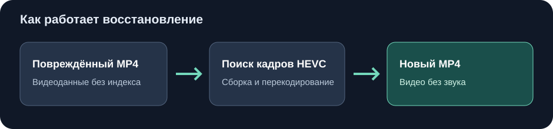

# Pocket 4 video salvage

Пробное восстановление **изображения** из повреждённых MP4 камеры DJI Osmo Pocket 4 Pro. Утилита ищет видеокадры HEVC в копии файла, собирает их в новый поток и создаёт MP4, который можно открыть в обычном плеере.

## Как запустить на Windows

1. Установите [Python](https://www.python.org/downloads/), если его нет на компьютере.
2. Скачайте репозиторий через **Code → Download ZIP** и распакуйте архив.
3. Один раз запустите **`Установить.cmd`**. Он установит FFmpeg в папку `vendor` внутри проекта.
4. Перетащите восстановленный `.MP4` на **`Восстановить_MP4.cmd`**.
5. Откройте `results/<имя_файла>_<номер>/recovered_no_audio.mp4` и просмотрите результат.

Исходный MP4 читается без изменений. Каждый запуск создаёт новую папку. Служебные `.LRF` и `.TRINF` перетаскивать не нужно.

## Что умеет и где пределы

- Проверено на повреждённом **вертикальном** HEVC-ролике `0153`: удалось получить около 48 секунд узнаваемого видео. Короткий пробный запуск самого скрипта также прошёл проверку декодером.
- Восстанавливается только картинка, **без звука**. Частота 59,94 кадра/с приблизительная; возможны пропуски, артефакты и неверная длительность.
- Параметры кодека в `portrait_0153.hevc` подходят для этого режима съёмки. Другие разрешения и режимы могут дать повреждённую картинку или не сработать.
- Успешное создание MP4 не означает, что все кадры верны. Обязательно просмотрите результат.

В папке результата остаются `extracted.hevc`, `repair.log` и `validation.log`. После проверки видео большой промежуточный `extracted.hevc` можно удалить.

Скрипт использует [imageio-ffmpeg](https://github.com/imageio/imageio-ffmpeg) версии 0.8.1, устанавливаемый отдельно, и не включает FFmpeg в репозиторий. Код утилиты распространяется по лицензии MIT.
